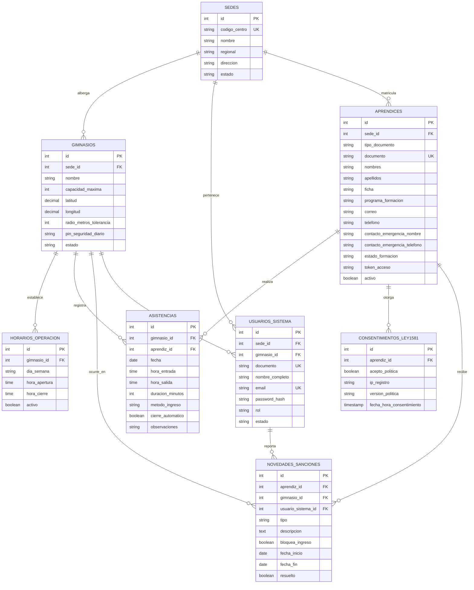

# Entregable 3: Modelo de Datos - GymSENA

## 1. Diagrama Entidad-Relación (ERD) Multi-Gimnasio

## 2. Diccionario de Datos Sintético

1. **`sedes`**: Permite escalar el sistema a cualquier Centro de Formación del SENA a nivel nacional (soporte multi-tenant).
2. **`gimnasios`**: Configuración de salas y recintos deportivos por centro, con control de capacidad máxima y coordenadas GPS antifraude.
3. **`horarios_operacion`**: Restricción de franjas horarias de Lunes a Viernes para bloqueo preventivo de registros fuera de jornada.
4. **`aprendices`**: Información sociodemográfica, académica y de emergencia del aprendiz. Almacena `token_acceso` para persistencia en el dispositivo móvil.
5. **`consentimientos_ley1581`**: Auditoría estricta de la autorización expresa para el tratamiento de datos personales en Colombia.
6. **`asistencias`**: Núcleo transaccional de ingresos y salidas con cálculo automático de permanencia y bandera de cierre automático diario.

