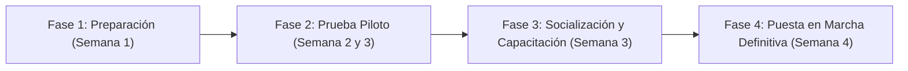

# Entregable 8: Plan de Implementación y Despliegue en el SENA

**Proyecto:** GymSENA - Control de Acceso y Servicios  
**Público Objetivo:** Bienestar al Aprendiz, Monitores de Gimnasio e Instructores de Cultura Física  

---

## 1. Estrategia de Implementación por Fases

Para asegurar una transición sin traumatismos desde las planillas de papel hacia el sistema PWA, se establece un plan de 4 fases progresivas:



### Fase 1: Preparación Técnica e Instalación del QR
1. **Configuración de Dominio y Servidor:**
   * Despliegue en servidor institucional o VPS bajo subdominio institucional (ej. `https://gym.sena.edu.co` o IP fija del Centro de Formación).
   * Certificado SSL/TLS gratuito con **Let's Encrypt** para garantizar HTTPS (requisito imprescindible para PWA y geolocalización segura).
2. **Generación e Impresión del Cartel QR:**
   * Impresión en tamaño mínimo **Media Carta (A5) o Carta (A4)** con acabado plastificado o marco acrílico de pared.
   * Ubicación estratégica: En el marco de la puerta de entrada del gimnasio y en el mostrador del monitor, a una altura accesible de 1.40 m.
   * Texto visible del cartel:
     > *"¡Bienvenido al Gimnasio del SENA! Escanea este código QR con tu celular para registrar tu ingreso en segundos. Si es tu primera vez, inscríbete una sola vez."*

### Fase 2: Prueba Piloto Controlada (2 Semanas)
* **Población Objetivo:** 2 fichas de formación seleccionadas (ej. ADSO y Entrenamiento Deportivo).
* **Objetivo:** Monitorear tiempos de respuesta con redes móviles reales de diferentes operadores (Claro, Tigo, Movistar, WOM) y red Wi-Fi institucional SENA.
* **Mecanismo de Convivencia:** Durante el piloto, el monitor mantiene una planilla física de respaldo únicamente para contingencias.

### Fase 3: Capacitación al Encargado / Monitor del Gimnasio
Se realiza una inducción práctica de **20 minutos** al monitor o practicante de turno:
1. Cómo iniciar sesión en `/login` desde la tablet o computador del gimnasio.
2. Cómo interpretar el velocímetro de aforo en vivo.
3. Cómo registrar la entrada asistida de un aprendiz sin celular mediante el formulario de "Registro Manual".
4. Cómo forzar la salida de un usuario si olvidó escanear al marcharse.

### Fase 4: Puesta en Marcha Definitiva y Retiro del Papel
* Retiro total de las planillas de papel en la entrada.
* Publicación de banner informativo en las pantallas digitales del Centro de Formación y difusión a través de correos de Bienestar al Aprendiz.

---

## 2. Guía Rápida para el Monitor de Turno (Hoja de Operación)

```text
=============================================================================
                GUÍA DE BOLSILLO - MONITOR GYMSENA
=============================================================================
1. INGRESO AL PANEL:
   - Ingresa en el navegador a: https://gym.sena.edu.co/login
   - Usuario: monitor@sena.edu.co | Clave asignada por Bienestar.

2. MONITOREO DE SALA:
   - En la pantalla principal verás el contador: "X / 30 personas".
   - Si el aforo llega a 30, el sistema bloqueará nuevos ingresos automáticamente.

3. APRENDIZ SIN CELULAR:
   - En la sección "Registro Manual de Asistencia", digita el documento del aprendiz.
   - Presiona "Registrar". El sistema marcará su Entrada o Salida según corresponda.

4. AL TERMINAR LA JORNADA:
   - No necesitas hacer nada manual; a las 23:59:00 el servidor cierra automáticamente
     todas las visitas que quedaron abiertas para iniciar en cero al día siguiente.
=============================================================================
```

---

## 3. Plan de Contingencia y Soporte

| Incidencia Posible | Causa Probable | Solución Operativa Inmediata |
|---|---|---|
| **Corte de energía o internet en el Centro** | Fallo de red eléctrica o ISP | Los aprendices con datos móviles siguen operando normalmente ya que el servidor está en la nube. Si no hay señal celular, el monitor anota documentos de forma provisional y los carga luego por el panel. |
| **Aprendiz no recibe cámara para leer el QR** | Permisos del navegador bloqueados | Se indica al aprendiz que ingrese directamente a la URL corta escrita en el cartel (ej. `gym.sena.edu.co`). |
| **Aprendiz reporta que no puede ingresar** | Sanción activa o fuera de horario | El monitor consulta el panel para informarle la causa exacta (novedad de Bienestar o fuera de la franja horaria). |

