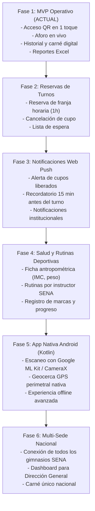

# Entregable 9: Roadmap de Evolución Tecnológica (GymSENA)

**Visión:** Evolucionar GymSENA desde un control de acceso ágil hacia una plataforma integral de salud, acondicionamiento físico y bienestar para la comunidad del SENA a nivel nacional.

---

## 1. Cronograma de Evolución por Fases

---

## 2. Detalle de las Fases Futuras

### Fase 2: Sistema de Reserva Previa de Turnos
* **Problema que resuelve:** Evitar desplazamientos innecesarios de aprendices en horas pico cuando el gimnasio está lleno.
* **Funcionalidad:**
  * Franjas configurables de 60 minutos con cupo máximo independiente (ej. 25 cupos por franja).
  * Reserva permitida con hasta 24 horas de anticipación desde la PWA.
  * Regla de cancelación: Liberación automática del cupo si el aprendiz no escanea el QR en los primeros 10 minutos de la franja.

### Fase 3: Notificaciones Web Push
* Integración del estándar **Web Push API** con **VAPID keys** en el Service Worker existente:
  * Aviso cuando el aforo baje del 80% para aprendices interesados.
  * Notificación informativa ante cambios imprevistos de horario o mantenimiento de máquinas.

### Fase 4: Módulo de Ficha Antropométrica y Rutinas
* Permite a los instructores de Cultura Física registrar:
  * Mediciones periódicas: Peso, estatura, porcentaje de grasa, Índice de Masa Corporal (IMC).
  * Planes de entrenamiento semanales (Fuerza, Hipertrofia, Resistencia, Movilidad).
  * Consulta interactiva de rutinas con animaciones de ejercicios directamente desde la PWA.

### Fase 5: App Android Nativa en Kotlin
* **Arquitectura:** MVVM (Model-View-ViewModel) + Jetpack Compose + Coroutines.
* **Integración API:** Consumo directo de los endpoints REST existentes de GymSENA (`/api/aforo`, `/procesar-acceso`, `/registrar-aprendiz`).
* **Seguridad Avanzada:**
  * Uso de **Google ML Kit Barcode Scanning** para leer el QR a 60 FPS sin retraso.
  * Verificación de ubicación vía **FusedLocationProviderClient** con validación criptográfica para garantizar que el dispositivo está dentro del perímetro del SENA.

### Fase 6: Despliegue Multi-Sede Nacional
* Aprovechando la arquitectura de datos existente con `sedes` y `gimnasios`:
  * Tablero consolidado para la Dirección General del SENA con estadísticas comparativas entre regionales (Antioquia, Bogotá, Valle, Atlántico, Santander, etc.).
  * Carné digital universal válido en cualquier gimnasio SENA del país.

